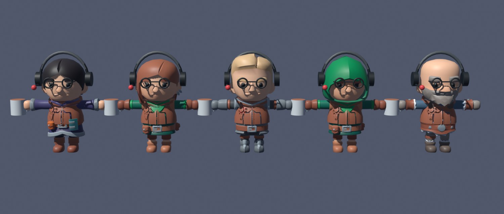
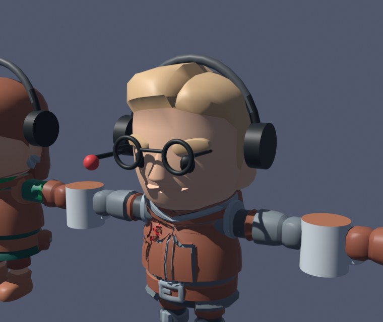

# Parts: new looks for Tower 3D's workers, made in Blender

`parts.blend` is where new parts for the workers are modelled by hand: glasses, headsets, hats, held things, outfits.
Each part is drawn on five KayKit bodies at once, and one command takes them all into Tower 3D. Adding a part needs no
code: its name says which slot it fills, and looks pick from every part in a slot.

## What's in the file

- **Rig** (collection `Rig`): KayKit's `Rig_Medium` in its rest pose, a T-pose 2.2 units tall facing −Y (Tower 3D's
  front), at the origin. Don't move it or edit its bones: parts are exported relative to this rest pose.
- **Stage** (`Stage`): the Knight, the real objects, at the origin. Model here.
- **Line-up** (`Lineup`): the Mage, the Rogue, the hooded Rogue and the Barbarian either side of the stage. They are
  collection instances of their body (`Bodies`, excluded) and of `Wardrobe`, so every part shows on every body. Put
  Rig in Pose Mode and pose it: all five follow, which is how a part is checked in motion.
- **Wardrobe** (`Wardrobe`): one collection per slot. Every mesh in it is exported, and nothing else is.
- **Pack** (`Pack`, excluded): the pack's own helmets, capes and gear on the rig, to look at or copy from.
- A text, `README`, open in the bottom editor: the short version of this page.

## Slots

A part is one mesh object in its slot's collection, named `<Slot>_<Name>` with letters, digits and `_` only
(`SLOTS` in `src/contract.ts`; the export refuses anything else and says why).

| Slot | How it's attached | Worn |
|---|---|---|
| `Head` | skinned like the pack's heads | instead of the body's head; keep skin in swatch (0,0) and hair in (1,0) |
| `Helm` | rigid on `head` | covering the head, instead of a hat: helmets, headsets |
| `Hat` | rigid on `head` | on top of the head: caps, beanies (a `.blend` built before the slot has no `Hat` collection: add one inside `Wardrobe`) |
| `Face` | rigid on `head` | glasses, masks |
| `Cape` | rigid on `chest` | |
| `Gear` | rigid on `handslot.r` | held while standing, put away while seated |
| `Prop` | rigid on any bone | besides the rest: badges, backpacks |
| `Outfit` | skinned over the body | vests, coats |

The examples are one of each kind to copy: `Face_RoundGlasses`, `Helm_Headset` (three swatches), `Gear_CoffeeMug`
(held as the pack's Mug is) and `Outfit_Vest`, cut from the Knight's body and pushed out, keeping its weights.

A first exercise: the headset's mic boom runs straight forward from the ear cup. Bend it toward the mouth (Edit Mode,
select the boom's far end and the mic, rotate about the cup), export, and look at it on the line-up and in Tower 3D.

## Making a part

1. **Open** `renderers/tower3d/parts/parts.blend` in Blender (5.2).
2. **Model** it on the Knight, in its slot's collection (click the collection in the Outliner first, and new
   objects land in it). Check it on the line-up: the heads differ in size, the bodies in girth.
3. **Paint** it: give it one material, an adventurer's atlas (`knight_texture`, `mage_texture`, `rogue_texture`,
   `barbarian_texture`). Each atlas is 8 × 4 swatches, and a face takes the colour of the swatch its UVs sit on. In the
   UV Editor, select faces, click a swatch to put the 2D cursor on it, then **UV › Snap › Selected to Cursor**. Each
   swatch is a gradient: spread the UVs up and down it for KayKit's shading. Swatches (0,0) and (1,0), the top-left
   two, are skin and hair: Tower 3D tints those per worker, on any part.
4. **Attach** it:
   - rigid: select the part, then Rig, enter Pose Mode, click the bone, **Ctrl+P › Bone**;
   - skinned: an Armature modifier on `Rig` and vertex groups named as its bones. **Data Transfer** (vertex groups,
     nearest face interpolated) from a body copies its weights; weight only the bones the clips move (`hips`, `spine`,
     `chest`, `head`, the arms, legs, hands and feet: not the `IK`, `control` or `kneeIK` bones).
5. **Save**, then **export**: `npm run tower3d:parts`. It writes `parts.glb` beside the file, or lists what to fix.
6. **Check**: `npm test` (the contract test reads `parts.glb`), then `npm run tower3d` and reload Tower 3D.

The eye in the Outliner hides a part on the stage only; the screen icon (Disable in Viewports) hides it on every body.
Neither stops a part from exporting.

## What changes in Tower 3D

Each look hashes, from a worker's session id, whether it wears something in a slot, and which part of the slot's
pool: the part scoring highest for that worker (rendezvous hashing, `hashed.ts`). A new part takes about one in N+1 of
the slot's wearers (N parts before it) and everyone else keeps what they wore; removing a part re-dresses only its
wearers. How many workers wear something in a slot never changes with the pool. The chances, pools and named outfits
are data in `renderers/tower3d/wardrobe.json` (`src/wardrobe.ts`), with each part's fit: a move, turn or scale over
where it was made to sit, by default and per head (or other part) it is worn with. The bots wear only the hats and
glasses of `models/wear.py`. A part is drawn at the size it was made, under its fit: a worker's build scales it with
the body.

## Files

| File | |
|---|---|
| `build.py` | builds `parts.blend` from `kaykit/Characters/adventurers.glb`: `sh parts.sh kit` |
| `parts.blend` | the parts made by hand: the source of `parts.glb`, committed |
| `export.py` | exports `Wardrobe` and `Rig` from it, for `scripts/tower3d-parts.ts`, which writes `parts.glb` on the pack's skeleton and skin: `npm run tower3d:parts` runs both |
| `parts.glb` | what Tower 3D loads beside the pack (`src/rig.ts`) |
| `shot.py` | renders `lineup.jpg` and `close.jpg`, these pictures: `sh parts.sh shot` |

`build.py` refuses to write over `parts.blend`, which holds the parts made in it. To build a fresh one (when the pack
is repacked, say), move the old file away, run `sh parts.sh kit`, and bring the parts over with **File › Append ›
Collection › Wardrobe** from the old file, then parent them again.

